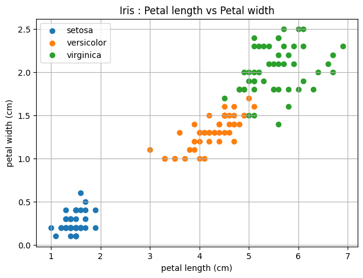
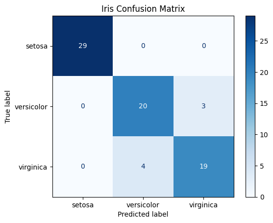

# Iris Decision Tree Classifier 🌸

## Project Overview
This project uses a Decision Tree Classification algorithm to classify Iris flowers into three species: Setosa, Versicolor, and Virginica based on their sepal and petal measurements.

## Technologies Used
- Python
- Pandas
- Matplotlib
- Seaborn
- Scikit-learn

## Dataset
Dataset: `iris.csv`

**Input Features:**
- Sepal Length (cm)
- Sepal Width (cm)
- Petal Length (cm)
- Petal Width (cm)

**Target Variable:** `species`

## Algorithm
**Decision Tree Classifier**

- Criterion: Gini
- Maximum Depth: 5
- Random State: 42
- Test Size: 50%

## Project Workflow
1. Load the Iris dataset.
2. Perform Exploratory Data Analysis (EDA).
3. Select input features and target variable.
4. Visualize petal length vs petal width.
5. Split data into training and testing sets.
6. Build and train the Decision Tree Classifier.
7. Predict Iris flower species.
8. Evaluate model performance.
9. Display the confusion matrix.

## Visualizations

### 1. Petal Length vs Petal Width
This scatter plot visualizes the relationship between petal length and petal width for different Iris species.



### 2. Confusion Matrix
The confusion matrix displays the actual and predicted classifications of the model.



**Note:** Keep both image files in the same folder as `README.md` and upload them to GitHub using these exact filenames.

## Model Evaluation
The model is evaluated using:
- Accuracy Score
- Confusion Matrix
- Classification Report
- Precision
- Recall
- F1-Score

## Installation

Install the required libraries:

```bash
pip install -r requirements.txt
```

## How to Run
1. Clone or download the repository.
2. Keep `iris.csv` in the project folder.
3. Install the required libraries.
4. Run the Python script:

```bash
python Iris_DecisionTreeClassifier.py
```

## Project Structure

```text
Iris_DecisionTree/
├── Iris_DecisionTreeClassifier.py
├── iris.csv
├── README.md
├── requirements.txt
├── iris_scatter_plot.png
└── confusion_matrix.png
```

## Conclusion
This project demonstrates Iris flower classification using a Decision Tree Classifier, along with data analysis, visualization, prediction, and model evaluation.